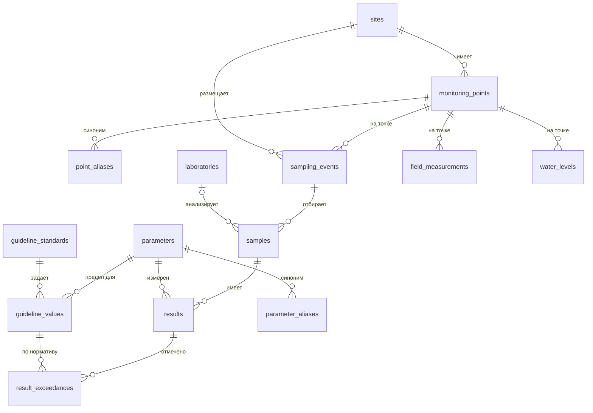

# EcoDB

ПЕРЕПИСАТЬ: для Windows Server

Реляционная база экологического мониторинга (воздух, поверхностные воды, подземные воды, почва, растительность). PostgreSQL 14 с PostGIS, для Query Layer ArcGIS Enterprise.

Пространственные данные — **WGS84 / EPSG:4326**. Схема приложения — `eco`.

## Требования

- [Docker](https://docs.docker.com/get-docker/) и Docker Compose
- Клиентские утилиты PostgreSQL (`psql`, `pg_isready`) на хосте — нужны для миграций

На macOS:

```bash
brew install libpq
# затем добавьте libpq в PATH, например echo 'export PATH="/opt/homebrew/opt/libpq/bin:$PATH"' >> ~/.zshrc
```

## Быстрый старт

```bash
git clone https://github.com/TimurMZh/EcoDB.git
cd EcoDB

docker compose up -d
chmod +x sql/apply.sh
./sql/apply.sh
```

Подключение по умолчанию:

|                 |                  |
| --------------- | ---------------- |
| Хост            | `localhost`      |
| Порт            | `5432`           |
| База            | `eco_monitoring` |
| Пользователь / пароль | `eco` / `eco`    |

При необходимости переопределите через `PGHOST`, `PGPORT`, `PGUSER`, `PGDATABASE`, `PGPASSWORD`.

Adminer (веб-интерфейс SQL) — [http://localhost:8080](http://localhost:8080). Сервер: `postgis`, учётные данные как выше.

## Миграции

Нумерованные SQL-файлы в `sql/migrations/` применяются по порядку. Уже применённые версии пропускаются (`eco.schema_migrations`).

| Файл                | Содержимое                                                      |
| ------------------- | --------------------------------------------------------------- |
| `001_init.sql`      | расширение PostGIS, схема `eco`, журнал миграций                |
| `002_tables.sql`    | таблицы, ограничения, справочники сред и кодов QC               |
| `003_indexes.sql`   | GIST по геометрии, btree-индексы, уникальные ключи              |
| `004_functions.sql` | триггеры, разбор лабораторных значений, проверка превышений, ETL staging |
| `005_views.sql`     | представления Query Layer для ArcGIS и права `SELECT`           |

Пересоздать схему с нуля:

```bash
./sql/apply.sh --reset
```

## Обзор схемы

Полная диаграмма с атрибутами: [docs/er-diagram.md](docs/er-diagram.md).



**Среды:** `air`, `surface_water`, `groundwater`, `soil`, `vegetation`.

**Коды QA/QC:** `A` / `B` / `C` (входят в последние результаты), `D` / `R` (отклонено / на проверке — исключены из `vw_latest_results`).

Справочники загружает фаза 2 (`python3 etl/phase2.py seed`) из `DB_input/Ecology_DB_general*.xlsx`.

## Импорт лаборатории

Следующая поставка (куда положить файл, какую команду запустить, что удаляет повторный запуск) — `docs/loading-data.md`.

Фаза 2 заполняет справочники и загружает Excel воздуха как партию `AIR_PILOT`:

```bash
./sql/apply.sh
python3 etl/phase2.py
```

`etl/phase2.py` вставляет сырые строки воздуха в `eco.staging_lab_import` и вызывает `fn_process_staging_import('AIR_PILOT')`. Функция сопоставляет синонимы точек и показателей, разбирает значения вроде `<0.01` и «не обн.», обновляет события, пробы и результаты и записывает сбои в строку staging (`process_error`). Пустые ячейки HCN сохраняются как «не обн.» (подтверждено PDF); остальные пустые ячейки воздуха остаются пустыми и отклоняются. ПДК из Excel хранится в `extra_json`, пределы берутся из `guideline_values`. Превышения считает триггер.

Фаза 3 загружает отчётные таблицы воды за 2025 год и именные скважины из PDF. Разбор воздуха она не использует. Пустые ячейки кварталов пропускаются; «нет» сохраняется и отклоняется как «не измерено». В PDF нет даты отбора, поэтому скважины датируются 2025-01-01 и помечаются в `extra_json`.

```bash
./sql/apply.sh
python3 etl/phase3.py
psql -h localhost -U eco -d eco_monitoring -v ON_ERROR_STOP=1 -f sql/verify_phase3.sql
```

Партии: `WATER_SURFACE_2025` (точки `SW-1`…`SW-4`), `WATER_GROUND_2025` (`GW-1`…`GW-10`), `WATER_WELLS_PDF` (`ФС-1`, `ФС-4`, `ФС-5`, `НС-2`). `GW-1`…`GW-4` повторяют значения поверхностных вод за 1 квартал; они остаются раздельными, пока это не подтверждено. ПДК в водных Excel равен `0` и не используется.

Фаза 4 присваивает коды QC и пишет акт выборочной сверки. Правила лежат в `eco.qa_rules` (A — сверено с PDF, B — ниже обнаружения по источнику, C — по умолчанию, R — на проверке, включая пустые ячейки, записанные как «не обн.»). D и R не попадают в `vw_latest_results`.

```bash
./sql/apply.sh
python3 etl/phase4.py
psql -h localhost -U eco -d eco_monitoring -v ON_ERROR_STOP=1 -f sql/verify_phase4.sql
```

Акт — `docs/qa_phase4_report.md`.

Фаза 5 — сдача в ArcGIS. Миграция `010` добавляет логин только на чтение `eco_gis`. `sql/verify_phase5.sql` проверяет, что у четырёх представлений есть уникальный `objectid` и столбец `geom`, что `vw_latest_results` скрывает коды QC D и R и что `vw_results_flat` по объекту `OSK` за 2020–2025 отвечает не дольше 3 секунд. Регистрация в ArcGIS Enterprise описана в `docs/ops-handover.md`. В этом репозитории сервера Enterprise нет, поэтому слои здесь не публикуются.

Пересчитать все превышения после изменения нормативов:

```sql
SELECT eco.fn_recalc_all_exceedances();
```

## Представления (Query Layer ArcGIS)

У каждого представления есть уникальный целочисленный `objectid` и необязательный `geom` (`Point`, 4326). Пустая геометрия допустима.

| Представление                | Одна строка на                                      | `objectid`      |
| ---------------------------- | --------------------------------------------------- | --------------- |
| `eco.vw_results_flat`        | лабораторный результат                              | `result_id`     |
| `eco.vw_exceedances_summary` | результат × норматив                                | `exceedance_id` |
| `eco.vw_latest_results`      | последний лабораторный результат пары (точка, показатель) | `result_id` |
| `eco.vw_water_levels`        | уровень подземных вод                               | `level_id`      |
| `eco.vw_sensor_latest`       | последний час автостанции на пару (точка, показатель) | `result_id`   |
| `eco.vw_sensor_latest_wide`  | автостанция (все последние загрязнители и метео)    | `point_id`      |
| `eco.vw_sensor_daily`        | сутки UTC × станция × показатель                    | синтетический   |

Зарегистрируйте их как Query Layer в ArcGIS Enterprise по схеме `eco`.

## Дымовая проверка

Выполняет пробные вставки, импорт и проверки превышений, затем **откатывает**:

```bash
psql -h localhost -U eco -d eco_monitoring -v ON_ERROR_STOP=1 -f sql/verify_phase1.sql
```

Пароль: `eco`. Сначала должна быть применена схема.

После загрузки данных фазы 2:

```bash
psql -h localhost -U eco -d eco_monitoring -v ON_ERROR_STOP=1 -f sql/verify_phase2.sql
```

## Набор данных качества воздуха по Оскемену

Почасовое качество воздуха по Оскемену (Усть-Каменогорск) берётся с AirData.kz: Казгидромет через открытую выгрузку. Файлы станций сохраняют опубликованные значения. Часы, которые станция не передала, остаются пустыми. Метеорология (температура, давление, влажность, ветер) — Open-Meteo ERA5 в координатах станции: в выгрузке по Оскемену файлов погоды нет. Обучения модели нет. В файлы станций входят все загрязнители из `raw/` (PM2.5, PM10, SO2, NO2, …).

```bash
python3 -m venv .venv
source .venv/bin/activate   # Windows: .venv\Scripts\activate
pip install -r dataset/requirements.txt
python dataset/fetch_oskemen_raw.py --parameters pm25 pm10 so2 no2 no co h2s o3 pmtot
python dataset/build_oskemen_stations.py
python dataset/plot_oskemen_stations.py   # карта по желанию
```

Результат попадает в `dataset/Oskemen/`. Панель идёт от первого часа PM2.5 в выгрузке до последнего часа. Переопределение: `--start` / `--end`. Сохраняется каждая станция хотя бы с одним переданным значением, в том числе ряд, который покрывает меньше 1% окна. Непереданные часы остаются пустыми.

Загрузка 13 станций в `eco_monitoring` (почасовые загрязнители → `eco.results` с `sample_type = hourly_sensor`, мкг/м³ как опубликовано; метеорология → `eco.meteo_observations`, соединение по станции и часу):

```bash
./sql/apply.sh
python etl/load_oskemen_stations.py
psql -h localhost -U eco -d eco_monitoring -v ON_ERROR_STOP=1 -f sql/verify_oskemen.sql
```

Лабораторные Query Layer остаются на пробах ПЭК. Слои автостанций в ArcGIS: `eco.vw_sensor_latest` (длинный), `eco.vw_sensor_latest_wide` (одна строка на станцию), `eco.vw_sensor_daily` (суточные min/avg/max по UTC). Дозагрузка: `python etl/load_oskemen_stations.py --since 2026-10-01`.

## Состав проекта

```
docker-compose.yml      PostGIS 14-3.4 + Adminer
docs/er-diagram.md      диаграмма сущность–связь
dataset/                выгрузка качества воздуха по Оскемену и панель станций
etl/phase2.py           справочники и загрузка AIR_PILOT
etl/load_oskemen_stations.py  почасовые станции Казгидромета и метео ERA5
etl/phase3.py           загрузка отчётов по воде и скважин из PDF
etl/phase4.py           коды QA/QC, выборка 5%, акт сверки
docs/loading-data.md    как импортировать новый Excel, PDF или период станций
docs/ops-handover.md    регистрация в ArcGIS; шаги дозагрузки указывают на loading-data.md
docs/roles.md           роли чтения, правки и администрирования, логины на сервере
sql/apply.sh            применить миграции или сбросить схему
sql/verify_phase1.sql   дымовая проверка фазы 1 (всегда ROLLBACK)
sql/verify_phase2.sql   проверка числа строк фазы 2 (без отката)
sql/verify_phase3.sql   проверка загрузки воды фазы 3 (без отката)
sql/verify_phase4.sql   проверки QA/QC фазы 4
sql/verify_phase5.sql   контракт Query Layer и проверка 3 секунд
sql/verify_roles.sql    проверка ролей и прав (миграция 011)
sql/migrations/         нумерованные скрипты схемы
```
