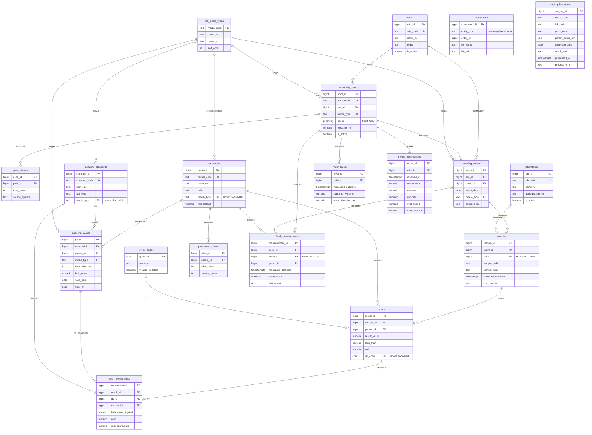

# Диаграмма сущность–связь EcoDB

Физическая модель схемы `eco` (PostgreSQL / PostGIS). Источник: `sql/migrations/002_tables.sql` и `012_oskemen_stations.sql`.

Мощности связей следуют объявленным внешним ключам. У `staging_lab_import` и `attachments` внешних ключей нет: staging — сырой снимок, вложения полиморфны.

## Предметные области

| Область | Таблицы |
|---|---|
| Пространство | `sites`, `monitoring_points`, `point_aliases` |
| Отбор проб | `laboratories`, `sampling_events`, `samples` |
| Результаты | `results`, `result_exceedances`, `ref_qc_codes` |
| НСИ / ПДК | `parameters`, `parameter_aliases`, `guideline_standards`, `guideline_values` |
| Поле | `field_measurements`, `water_levels` |
| Датчики | `meteo_observations`; почасовые загрязнители лежат в `samples` (`sample_type = hourly_sensor`) и `results` |
| Прочее | `ref_media_types`, `attachments`, `staging_lab_import` |

## Примечания

- Уникальность `sampling_events`: `(point_id, event_date, media_type)`.
- Уникальность `results`: `(sample_id, param_id)` — повторный импорт обновляет строку.
- Уникальность `guideline_values`: `(standard_id, param_id, media_type, valid_from)`.
- `attachments.entity_type` — одно из: `site`, `monitoring_point`, `sampling_event`, `sample`, `result`, `laboratory`.
- Сначала загружается `staging_lab_import`, затем `fn_process_staging_import()` пишет в события, пробы и результаты.
- Почасовые значения Казгидромета — это `samples.sample_type = 'hourly_sensor'` (одна проба на станцию и час) и `results` в `ug/m3`. Пустые ячейки источника не хранятся. Лабораторные Query Layer этот тип пробы исключают.
- У `meteo_observations` нет внешнего ключа на `samples`. Соединение: `meteo.point_id = sampling_events.point_id` и `meteo.observed_at = samples.collection_datetime` (`vw_sensor_hourly`, `vw_sensor_latest`).
- Представления (`vw_results_flat`, `vw_exceedances_summary`, `vw_latest_results`, `vw_water_levels`, `vw_sensor_latest`, `vw_sensor_latest_wide`, `vw_sensor_daily`) сущностями не являются: это проекции Query Layer поверх этой модели.
